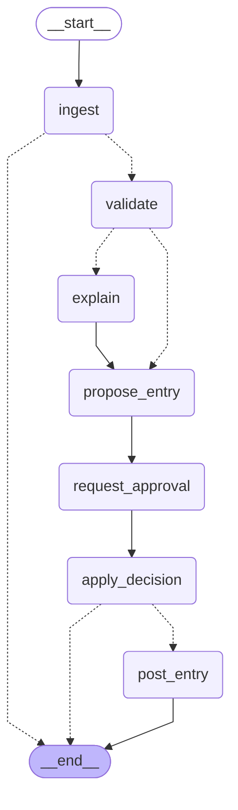

# invoice-agent

An agentic system that processes supplier invoices for small French businesses: ingestion (Factur-X first, PDF fallback), deterministic checks, purchase-order matching, proposed accounting entry, human approval, and posting through an MCP server, with a full audit trail.

Status: under construction. See [CLAUDE.md](CLAUDE.md) for the design principles and conventions.

## Getting started

```bash
uv sync                                       # install dependencies
uv run pre-commit install --install-hooks     # lint + conventional commit hooks
cp .env.example .env                          # then edit the values
docker compose up -d db                       # local PostgreSQL 16
uv run pytest tests/unit -q
```

Architecture decisions are recorded in [docs/adr](docs/adr). The invoice test set used for tests and
evaluation lives in `tests/fixtures/invoice-test-set/`.

## Configuration

Settings come from environment variables (see `.env.example`): `DATABASE_URL`, `IBAN_HASH_KEY`
(at least 16 characters, keeps IBANs out of the database) and optional ingestion limits.

## The agent

A [LangGraph](https://langchain-ai.github.io/langgraph/) graph runs each invoice, with its
state checkpointed in Postgres. The model reads PDFs without an embedded XML and explains
anomalies; every other step is deterministic Python, and nothing is posted without a human.



- `ingest` and `validate` wrap the services of the earlier steps (Factur-X or LLM extraction,
  then VAT, totals, SIREN, IBAN, duplicates, purchase-order matching, injection checks).
- `explain` runs only when the rules found anomalies. The model explains each one to the
  reviewer in plain French, and may look things up in the ledger through four read-only tools
  (at most four calls, no write tool in the list). It sees the findings and the figures, never
  the free text of the document. Its text is advice: it changes no status, no entry and no
  decision, a code it invents is dropped, and if it cannot answer the run goes on without it.
- `propose_entry` builds the accounting entry in plain Python (a charge line per VAT rate, the
  deductible VAT on 44566, the gross total on the supplier's account). When no sound entry
  exists (unknown supplier, totals that do not add up...) it says why and the invoice can only
  be rejected: no account is ever guessed.
- `request_approval` stops the run with `interrupt`. The reviewer is shown figures, anomaly
  codes, the explanation and the entry, never the document text. The run waits in the
  database, across restarts.
- `apply_decision` approves or rejects, and records who decided in the audit log.
- `post_entry` runs only after an approval, with the entry the reviewer saw, through the MCP
  ledger's idempotent tool (one key per invoice). A refusal fails the invoice with the ledger's
  code; an outage is retried; a crash between the ledger and the database replays into a
  single entry.
- Each node has its own transaction and can be replayed: if the process dies after a node
  committed and before its checkpoint was written, the run continues without doing it twice.
- Design: [ADR-0007](docs/adr/0007-agent-graph-and-tools.md),
  [ADR-0009](docs/adr/0009-graph-in-the-worker.md),
  [ADR-0010](docs/adr/0010-entry-proposal-and-posting.md),
  [ADR-0011](docs/adr/0011-explaining-anomalies.md).

```bash
uv run python -m invoice_agent.agent seed                  # demo suppliers and purchase orders
uv run python -m invoice_agent.worker enqueue              # queue the PDFs under DOCUMENT_ROOT
uv run python -m invoice_agent.worker                      # runs each invoice up to the pause
uv run python -m invoice_agent.agent pending               # what is waiting for a decision
uv run python -m invoice_agent.agent show <invoice-id>     # the entry that would be posted
uv run python -m invoice_agent.agent approve <invoice-id> --by you@example.com
uv run python -m invoice_agent.agent reject  <invoice-id> --by you@example.com --comment "..."
```

## Running the worker

```bash
docker compose up -d db
uv run alembic upgrade head
cp .env.example .env                              # set DOCUMENT_ROOT and IBAN_HASH_KEY
uv run python -m invoice_agent.worker enqueue     # queue every PDF under DOCUMENT_ROOT
uv run python -m invoice_agent.worker             # process jobs until SIGINT / SIGTERM
```

There is one kind of job, `process`: it runs the graph above for one document. Jobs live in the `jobs` table: claimed with `FOR UPDATE SKIP LOCKED`, leased, retried with
exponential backoff, and marked `dead` after the last attempt. The PDF parser runs in a child
process with a deadline. See `docs/adr/0005-worker.md`.

## Observability and evaluation

Every model call goes through `llm/`: it is timed, bounded, priced and traced in
[Langfuse](https://langfuse.com), which runs locally from the compose file.

```bash
docker compose --profile observability up -d      # Langfuse on http://localhost:3000
uv run --env-file .env python -m invoice_agent.worker
```

Set `ANTHROPIC_API_KEY` and the `LANGFUSE_*` variables in `.env` (see `.env.example`; the
compose file creates the local admin account and project from them). Without Langfuse keys
tracing is off; without an API key the worker skips PDFs that need the model.

- **One trace per invoice**: the job, one span per graph node and the model call share a
  trace, also after the human pause; the trace id is stored in the audit events. IBANs and API keys are masked before anything is sent.
- **Evaluation** on the 21 golden invoices, also run as a Langfuse experiment on the dataset
  `invoice-golden`:

```bash
uv run --env-file .env python -m evals.run --suite smoke --dry-run   # plan and worst-case cost
uv run --env-file .env python -m evals.run --suite full --yes --max-cost 0.25
```

Calling the API costs money: nothing is sent without `--yes`, and `--max-cost` stops the run.

First measurement (Haiku 5.5, 21 invoices, 0.01 USD in total): field accuracy 94.5 %,
anomaly precision 100 % and recall 84.6 % (the rest need invoice history), p50 latency
2.5 s. One document that hides an instruction between table cells is refused by the
grounding check, as intended. Details in [docs/evals/latest.md](docs/evals/latest.md) and
[ADR-0006](docs/adr/0006-llm-and-observability.md).

The `explain` suite measures the node that explains anomalies, with checks written as code
(no second model as a judge). A run keeps what the model wrote, so it can be scored again
offline when a metric changes:

```bash
uv run --env-file .env python -m evals.run --suite explain --yes --max-cost 0.25
uv run python -m evals.rescore evals/results/<run>.json --report docs/evals/explain.md
```

First measurement (Haiku 5.5, 8 invoices with anomalies, 0.005 USD): every anomaly covered, no
invented code, no figure outside the case or the tool results (a gap between two amounts of
the case counts as grounded), tools used in 3 cases out of 8 and always read-only, the
injection case flagged as a risk without following it, p50 latency 3.9 s. The model's texts
are in [docs/evals/explain.md](docs/evals/explain.md). The thresholds are in
[evals/thresholds.yaml](evals/thresholds.yaml), set a little under this measurement; a run (or a
rescoring) below one of them exits with code 1.

## The ledger and its tools

The accounting system the agent posts to is a mock, kept apart from the agent on purpose: its
own Postgres schema (`ledger`) and an MCP server that is the only way in.

```bash
uv run alembic upgrade head          # creates the ledger schema
uv run python -m ledger seed         # suppliers, purchase orders and chart of accounts
uv run python -m ledger              # MCP server over stdio (use --read-only to drop the write tool)
```

Five read tools (`get_supplier`, `list_open_purchase_orders`, `get_purchase_order`,
`find_invoices`, `get_chart_of_accounts`) and one write tool, `post_journal_entry`, which needs
an idempotency key: posting twice writes once, the same key with another content is refused,
and an invoice is booked once whatever the key. Posted entries cannot be changed.

On the agent side, `invoice_agent.tools.ledger` gives a `LedgerReader` and a `LedgerWriter`
over one connection with explicit timeouts and bounded retries. See
[ADR-0008](docs/adr/0008-ledger-mcp.md).
